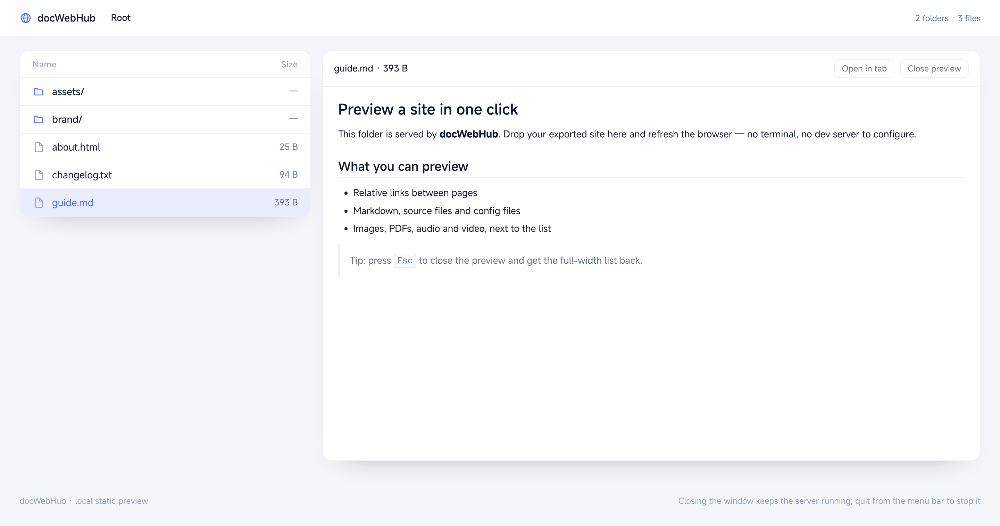
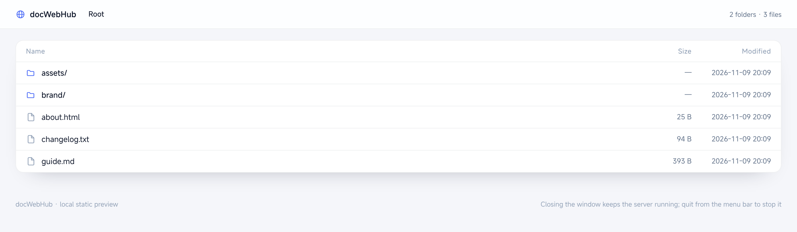
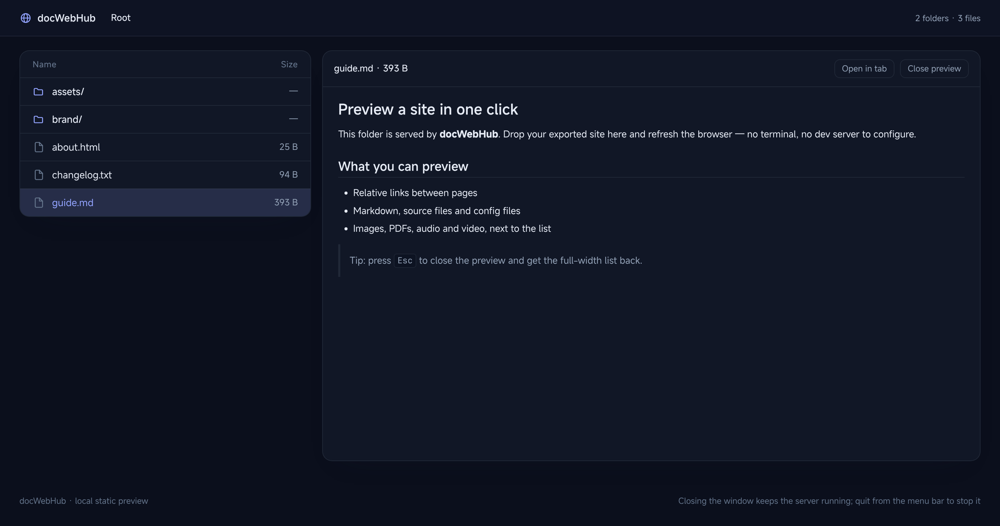

<div align="center">


# docWebHub

**Turn any folder into a website — in one click.**

docWebHub is a small desktop app for looking at a website or a folder of documents on your
own computer. Pick a folder, and it opens in your browser. No command line, no setup, and no
extra software to install.

[](#install)
[](locales/)
[](LICENSING.md)



</div>

## Why you might need it

You exported a website, downloaded a template, or received a folder of documents from someone.
To see it the way a visitor would, the folder has to be opened by a web server. Until now that
meant opening a terminal and remembering a command.

docWebHub is the missing **Preview** button: open the app, choose the folder, and the site
appears in your browser. Everything stays on your computer.

It is handy when you want to:

- check an exported site or template before uploading it
- read a folder of Markdown, Word, Excel, PowerPoint, PDF, or CAD files
- show a site on your phone or another computer on the same Wi-Fi
- keep a local copy of documentation that opens like a real website

## Start here

1. **Download** the version for your computer below and open it.
2. A small window appears with a link, such as `http://192.168.1.7:9102`.
3. Click **Choose folder…** and pick the folder you want to look at.
4. Click the link (or **Copy link** and paste it into your browser). The folder opens like a
   website. Refresh the page after you change a file.
5. Close the window when you are done. docWebHub keeps running in the menu bar (macOS) or the
   notification area (Windows and Linux). Quit it from there to stop the server.

The first time you open a downloaded app, your computer may ask for confirmation. On macOS,
right-click the app and choose **Open**. On Windows, choose **More info → Run anyway** if
SmartScreen appears. The builds are not signed with a paid certificate, so this is expected.

## What you can preview

| If the folder has… | You see… |
|---|---|
| A website with a home page (`index.html`) | The site itself: pages, styles, images, and working links |
| Documents | Markdown shown as a formatted page; Word, Excel, and PowerPoint files in a reader with zoom and page controls |
| Drawings | DXF and DWG files you can pan, zoom, and inspect by layer |
| Images, PDFs, audio, video | A built-in viewer next to the list |
| Code and text files | A readable preview with syntax highlighting |

Folders without a home page open as a clean file list. Click a file to see it on the right;
press `Esc` to close the preview and get the full-width list back.

<div align="center">

<p><em>Folders without a home page open as a tidy file list</em></p>
</div>

docWebHub follows your system's light or dark appearance:

<div align="center">

<p><em>No separate theme to set up — it matches your desktop</em></p>
</div>

## Share with your phone or tablet

By default docWebHub makes the folder available on your local network, and the address in its
window is the one other devices can use. Type that address into a phone, tablet, or another
computer on the same Wi-Fi, and the same folder opens there. Tailscale addresses are detected
and labelled automatically if you use Tailscale.

## Sharing and privacy

Because the folder is visible on your local network by default:

- **Set a password** before using docWebHub on a network you do not trust, such as hotel, café,
  or office Wi-Fi. Enter a username and a password under **Auth** and click **Apply**.
- **Choose `Localhost only`** under **Bind** to make the folder visible only on this computer.
- A password stops other people from opening the folder, but it does **not** encrypt the
  traffic. That is fine on a trusted home network or Tailscale; on public Wi-Fi, use
  `Localhost only` instead.
- The file list is always visible for folders without a home page. To keep something private,
  move it out of the folder or turn on the password.

Nothing is uploaded anywhere. docWebHub only reads the folder you choose and shows it to
whoever can reach the address.

## Install

### Download

Prebuilt apps are attached to each [release](../../releases):

| System | File | Notes |
|---|---|---|
| macOS 11+ | `docWebHub.app` | Apple Silicon and Intel builds, ad-hoc signed |
| Windows 10+ | `docwebhub-windows-amd64.exe` | No console window |
| Linux | `docwebhub-linux-amd64` + `docwebhub.desktop` | Needs GTK 3 and Ayatana AppIndicator 3 at runtime |

**macOS**: open the `.app` and drag it into Applications if you want to keep it there. The
first launch needs right-click → **Open** because the app is not notarized.

**Windows**: double-click the `.exe`. Keep it wherever you like.

**Linux**: keep the executable and the `.desktop` file together, then run the executable. Most
desktops already include GTK 3 and the AppIndicator library. If the window does not appear, on
Arch install `gtk3` and `libayatana-appindicator`; on Debian or Ubuntu install `libgtk-3-dev`
and `libayatana-appindicator3-dev`.

### Build it yourself

You need Go 1.24 or newer and run `./build.sh`; the optional Office and CAD viewers are downloaded and packed into
the app automatically. A plain `go build` also works, but leaves those two viewers out.

## Using the window

| Control | What it does |
|---|---|
| **Folder** | The folder being shown. **Choose folder…** switches it and remembers the choice. |
| **Address** | The link to open. Click it, or use **Copy link** to paste it somewhere else. |
| **Port** | The number at the end of the link. Change it only if another program is already using the default (`9102`); docWebHub checks before switching. |
| **Bind** | Who can connect: every device on your network, only this computer, or one specific network connection. |
| **Auth** | The optional username and password visitors must enter. Leave both fields empty and click **Apply** to turn protection off. |
| **Active connections** | A recent list of requests, useful when checking whether a page loaded or a login failed. |
| **Language** | The language of the app and the file listing. `System default` follows your computer. |

Everything is saved as soon as you change it.

## Common questions

**Do I need to install anything else?**
No. docWebHub is a single app, and the Office and CAD viewers are built in.

**Does it work offline?**
Yes. It does not contact the internet; it only reads the folder you choose.

**Can I edit files while it is running?**
Yes. Save your changes and refresh the browser page.

**Why does the address sometimes change?**
The port is picked from `9102` upward, so a second copy of docWebHub can run at the same time.
You can set a fixed port in the window.

**Is my folder uploaded?**
No. Nothing leaves your computer unless someone else on your network opens the address.

**How do I stop it?**
Closing the window only hides it. Quit from the menu bar (macOS) or the notification area
(Windows and Linux) to stop the server.

## For developers

The rest of this page is for people who want to run docWebHub from a terminal, understand how
it works, or contribute. You can stop reading here if you only want to preview a folder.

### Command line

| Flag | Default | Description |
|---|---|---|
| `-dist <path>` | `dist` | Folder to show. Overrides the settings file. |
| `-no-gui` | `false` | Run the server only, without the window. |
| `-open` | `false` | Open the site in your default browser after start. |
| `-lang <code>` | from settings | Interface language, for example `en` or `zh-CN`. Empty follows the settings file, which follows the system. |
| `-version` | | Print the version and exit. |

### Settings file

Settings live in the usual per-user location:

| OS | Path |
|---|---|
| macOS | `~/Library/Application Support/docwebhub/config.json` |
| Windows | `%AppData%\docwebhub\config.json` |
| Linux | `$XDG_CONFIG_HOME/docwebhub/config.json` |

```json
{
  "root": "/Users/you/Sites/portfolio",
  "port": 9200,
  "bind": "0.0.0.0",
  "username": "admin",
  "passwordHash": "sha256$<salt>$<digest>"
}
```

- `root` is ignored if the folder no longer exists — docWebHub falls back to `dist/` next to the app.
- `bind` falls back to all interfaces if the saved address is gone (a Tailscale tunnel that is
  down, say), and to `127.0.0.1` if even that fails.
- `passwordHash` is a salted SHA-256 digest; the plaintext password is never written to disk.
- The file is written atomically (temp file + rename) with `0600` permissions.

### How it works

- **Bind first, serve second.** The port is claimed before the web server starts, so you never
  see a half-started server. If the default port is taken, the next one is tried.
- **Switching folders is instant.** The folder is swapped without restarting the server or
  changing the address, and pages already open keep working.
- **Passwords are hashed.** A random salt plus SHA-256, compared in constant time. It is
  deliberately fast because the password is checked on every request, including each image.
- **Listings are rendered by the app**, not by Go's file server, so long names, hidden files,
  dark mode, syntax highlighting, and Markdown all behave. Markdown is rendered as a document;
  raw HTML is shown as text, and only `http(s)`, `mailto`, `tel`, and relative links survive.
- **Large folders load in pages.** 100 rows at a time; **Load more** appends the next page from
  a short-lived snapshot instead of rescanning the folder.
- **Only media is cached.** Everything else is `no-store`, so a rebuild shows up on the next
  refresh. Video and audio are `no-cache`, so scrubbing does not download the same range twice
  while a replaced file still wins on the next load.
- **Links cannot leave the folder.** The preview and the listing share one path resolver: a
  symlink pointing outside the site folder is treated as missing, along with everything below a
  directory link. `os.Root` resolves the path in the kernel, so there is no gap between checking
  and opening — that is why the build needs Go 1.24.
- **`index.htm` works too.** Go's file server only knows `index.html`; directories whose entry
  page is `index.htm` are forwarded explicitly, while `/dir → /dir/` redirects are preserved.

### Project layout

```
.
├── main.go                # startup: flags, settings, server, window
├── internal/
│   ├── config/            # user settings, atomic JSON writes
│   ├── web/               # listening, static serving, auth, listing page
│   ├── ui/                # native windows: AppKit / Win32 / GTK
│   └── openurl/           # opening the default browser
├── locales/               # one JSON file per interface language
├── assets/                # app icon sources
├── screenshots/           # screenshots for this README
├── tools/                 # packaging and icon helpers
└── build.sh               # cross-platform build
```

### Translations

Every user-visible string lives in [`locales/`](locales/) as a flat JSON file, one per language,
embedded into the app. The browser file list and the sign-in page use the same strings as the
window, so a switch covers the whole app. To add a language, copy `locales/en.json`, translate
the values, and run `go test ./internal/i18n/` — it fails if a key or a `%s` placeholder is
missing. See [`locales/README.md`](locales/README.md) for details, including a prompt you can
hand to an AI translator.

## Contributing

Issues and pull requests are welcome. For anything larger than a bug fix, open an issue first so
we can agree on the approach. `go vet ./...` and `go test ./...` should stay green, and
`./build.sh` must keep producing all three platforms.

## License

docWebHub is **dual-licensed**:

- **AGPL-3.0** — [LICENSE](LICENSE). Free for personal and open-source use. If you modify it, or
  let other people use your version over a network, you must publish your changes under the same
  license and keep the original notices.
- **Commercial license** — [LICENSING.md](LICENSING.md). For teams that cannot accept those
  terms: bundling it into a closed-source product, or offering it as a hosted service, without
  publishing source.

Contributions are accepted under the same model, so the project can keep offering both.

---

If docWebHub saves you a terminal session, a star helps other people find it.
